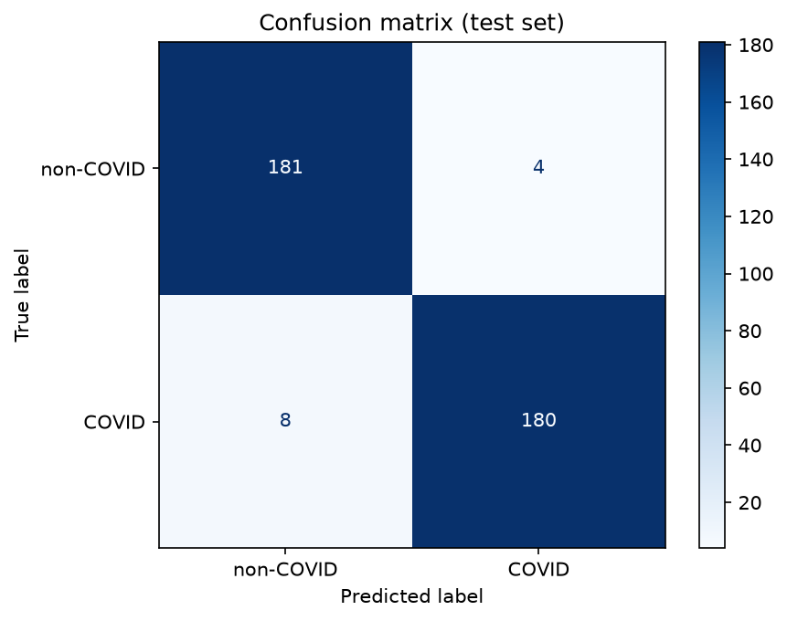

# COVID-19-Klassifikation aus CT-Aufnahmen

Ein binärer Bildklassifikator, der vorhersagt, ob eine CT-Aufnahme der Lunge Anzeichen von COVID-19 zeigt oder nicht. Umgesetzt mit PyTorch und Transfer Learning (ResNet18, vortrainiert auf ImageNet).

> **Hinweis:** Dies ist ein Lern- und Portfolio-Projekt. Es ist kein Medizinprodukt und darf nicht zur Diagnose verwendet werden.

## Ergebnisse

Finales Modell (ResNet18 mit Fine-Tuning, 15 Epochen, bester Checkpoint nach Validierungsgenauigkeit), einmalig auf dem zurückgehaltenen Test-Set ausgewertet (373 Bilder):

| Kennzahl | Wert |
| --- | --- |
| Test-Accuracy | 96,8 % |
| Sensitivität (COVID gefunden) | 95,7 % (180 von 188) |
| Spezifität (Non-COVID erkannt) | 97,8 % (181 von 185) |
| Precision (COVID) | 97,8 % (180 von 184) |



Das Modell hat 8 COVID-Fälle übersehen (False Negatives) und 4 Fehlalarme ausgelöst (False Positives).

### Eingefrorener Backbone vs. Fine-Tuning

| Variante | Epochen | Validierungs-Accuracy |
| --- | --- | --- |
| Backbone eingefroren, nur die neue Klassifikationsschicht trainiert | 5 | 0,793 |
| Gesamtes Netz per Fine-Tuning trainiert | 5 | 0,858 |
| Gesamtes Netz per Fine-Tuning trainiert (finales Modell) | 15 | 0,962 (beste Epoche), 0,968 auf dem Test-Set |

Das Entsperren des Backbones hat deutlich geholfen: Die ImageNet-Merkmale sind nicht auf graue CT-Schnittbilder zugeschnitten, und durch das Anpassen des Netzes hat sich das Ergebnis verbessert.

## Datensatz

[SARS-CoV-2 CT scan dataset](https://www.kaggle.com/datasets/plameneduardo/sarscov2-ctscan-dataset) von Kaggle: etwa 2.500 CT-Bilder in zwei Klassen (COVID und Non-COVID) als PNG-Dateien.

- Aufteilung: 70 % Training, 15 % Validierung, 15 % Test
- Der Split ist stratifiziert (in jeder Menge gleiches Klassenverhältnis) und nutzt `random_state=42`, ist also reproduzierbar
- Vor dem Training habe ich die Bildgrößen pro Klasse verglichen, um auszuschließen, dass das Modell die Klassen allein an der Bildgröße unterscheiden kann

## Vorgehen

1. **Vorverarbeitung** (`preprocess.py`)
   - Dateipfade und Labels sammeln (0 = Non-COVID, 1 = COVID)
   - In Train / Validation / Test aufteilen, bevor irgendeine Transformation angewendet wird
   - Auf 224 x 224 skalieren, in Tensor umwandeln, mit ImageNet-Mittelwert und -Standardabweichung normalisieren
   - Augmentation nur für das Trainings-Set: zufälliges horizontales Spiegeln, zufällige Rotation bis 10 Grad
   - Eigene PyTorch-`Dataset`-Klasse und `DataLoader` (Batch-Größe 32)
2. **Modell** (`model.py`)
   - ResNet18 mit ImageNet-Gewichten
   - Die letzte Fully-Connected-Schicht wird durch eine neue Schicht mit 2 Ausgängen ersetzt
3. **Training** (`train.py`)
   - Loss: Cross Entropy, Optimizer: Adam (Learning Rate 0,001)
   - Validierung nach jeder Epoche, das beste Modell nach Validierungs-Accuracy wird in `best_model.pth` gespeichert
4. **Auswertung** (`evaluate_model.py`)
   - Lädt den besten Checkpoint und wertet einmalig auf dem Test-Set aus
   - Confusion Matrix und Classification Report (Precision, Recall)

## Projektstruktur

```
.
├── preprocess.py        # Daten laden, Split, Transforms, Dataset, DataLoader
├── model.py             # ResNet18 mit neuer Klassifikationsschicht
├── train.py             # Trainingsschleife mit Validierung und Checkpoint
├── evaluate_model.py    # Test-Auswertung, Confusion-Matrix-Plot
├── confusion_matrix.png # Ergebnisgrafik
└── README.md
```

## Ausführen

```bash
pip install torch torchvision scikit-learn matplotlib pillow
```

1. Datensatz von Kaggle herunterladen und oben in `preprocess.py` die beiden Pfade zu den Klassenordnern eintragen.
2. Modell trainieren:

   ```bash
   python train.py
   ```

3. Besten Checkpoint auf dem Test-Set auswerten:

   ```bash
   python evaluate_model.py
   ```

Das Gerät wird automatisch gewählt (CUDA, Apple MPS oder CPU).

Mit Docker

Dann musst du weder Python noch PyTorch selbst einrichten. Das Image enthält nur den Code und die Abhängigkeiten. Den Datensatz hängst du beim Start als Ordner ein, und die Ergebnisse landen in output/ auf deinem Rechner.

docker build -t covid-ct-classification .

mkdir -p output
cp best_model.pth output/

docker run --rm \
  -v "$(pwd)/data:/data" \
  -v "$(pwd)/output:/app/output" \
  covid-ct-classification

Der Container wertet den Checkpoint auf dem Test-Set aus und schreibt die Confusion Matrix nach output/. Er rechnet auf der CPU und kommt dabei auf dieselben Zahlen wie mein lokaler Lauf.

Zum Trainieren im Container hängst du den Befehl hinten an:

docker run --rm \
  -v "$(pwd)/data:/data" \
  -v "$(pwd)/output:/app/output" \
  covid-ct-classification python train.py

Auf der CPU dauert das deutlich länger als auf einer GPU.


## Einschränkungen

- **Keine Patienten-IDs im Datensatz.** Der Split erfolgt zufällig pro Bild, deshalb können sehr ähnliche Schnitte desselben Patienten sowohl im Trainings- als auch im Test-Set liegen. Die berichtete Test-Accuracy ist daher vermutlich optimistischer, als sie bei komplett neuen Patienten wäre.
- **Ein einzelner Datensatz, keine externe Validierung.** Das Modell wurde nicht an CT-Aufnahmen aus anderen Kliniken oder von anderen Geräten getestet. Dort wäre die Leistung wahrscheinlich geringer.
- **Unruhige Validierungskurve.** Die Validierungs-Accuracy schwankte zwischen den Epochen (zum Beispiel 0,74 in Epoche 5 und 0,83 in Epoche 11). Eine kleinere Learning Rate beim Fine-Tuning würde vermutlich zu einer ruhigeren Kurve führen. Deshalb wird der beste Checkpoint gespeichert und nicht einfach die letzte Epoche verwendet.
- **Übersehene Fälle wiegen schwerer.** Im medizinischen Kontext sind False Negatives der kritischere Fehler. Das Modell hat im Test-Set 8 von 188 COVID-Fällen übersehen.

## Mögliche nächste Schritte

- Gruppenbasierter Split, der ähnliche Schnitte zusammenhält (zum Beispiel durch Clustering von Bild-Embeddings)
- Auswertung auf einem zweiten, unabhängigen CT-Datensatz
- Kleinere Learning Rate beim Fine-Tuning und Vergleich mehrerer Läufe
- Grad-CAM-Visualisierungen, um zu prüfen, ob das Modell auf Lungengewebe achtet und nicht auf Bildartefakte